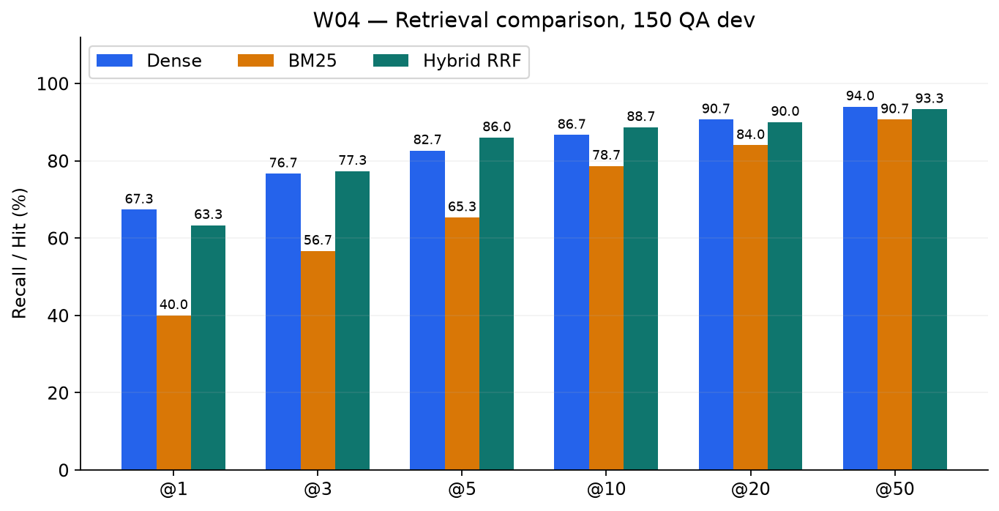
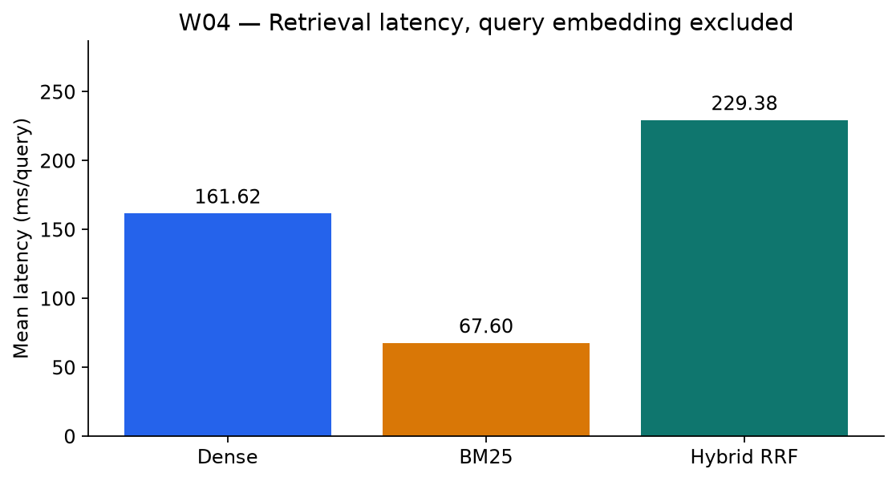

# W04 — Hybrid BM25/Dense + RRF: retrieval comparison

Thời gian kế hoạch: **18/10–24/10/2026**. Thực nghiệm chung: **31/10/2026**. Đóng gói GitHub và kiểm tra lại: **01/11/2026**; không backdate lịch sử Git.

## Thiết kế thực nghiệm

150 QA dev = 46 giao thông + 104 lao động. So sánh Dense top-50, BM25 top-50, Hybrid RRF top-50 trên cùng corpus/domain filter. PyVi giữ tiếng Việt; Dense 768 chiều normalize/cosine. BM25Okapi k1=1.5, b=0.75, epsilon=0.25, lower-case tokens; IDF tính trên corpus chung rồi lọc domain. RRF = Σ 1/(60+rank), rank từ 1, không cộng raw cosine/BM25. Hai nhánh chạy tuần tự; RRF nhận diện trùng theo text. Không CrossEncoder, query expansion hoặc LLM trong ba phương án W4.

| Chỉ số | Dense | BM25 | Hybrid RRF |
|---|---:|---:|---:|
| Recall@1 | 67,33% | 40,00% | 63,33% |
| Recall@3 | 76,67% | 56,67% | 77,33% |
| Recall@5 | 82,67% | 65,33% | 86,00% |
| Recall@10 | 86,67% | 78,67% | 88,67% |
| Recall@20 | 90,67% | 84,00% | 90,00% |
| Recall@50 | 94,00% | 90,67% | 93,33% |
| MRR@50 | 0,7376 | 0,5176 | 0,7231 |

Top-5: Dense 124/150, BM25 98/150, Hybrid 129/150. So với Dense, Hybrid cải thiện 9 câu, suy giảm 4, tăng ròng 5 câu (+3,33 điểm phần trăm). Hybrid tốt hơn ở @3/@5/@10; Dense tốt hơn ở @1/@20/@50/MRR. Không kết luận Hybrid tốt hơn mọi chỉ số hoặc có ý nghĩa thống kê.

Latency trung bình, không gồm query embedding: Dense 161,62 ms; BM25 67,60 ms; Hybrid 229,38 ms. Không phải latency chatbot end-to-end. [Bộ 150 QA](../_shared/data/qa_dev_150.jsonl), [kết quả từng câu đã lọc W4](predictions.jsonl), [snapshot implementation](../_shared/source_snapshot/runtime.py).

## Theo dõi trên GitHub

- [Milestone Tuan4](https://github.com/whyalwaysme2x4/VietnameseLegal-QuestionAnsweringSystem/milestone/1).
- [Issue triển khai của Tăng Minh Quang](https://github.com/whyalwaysme2x4/VietnameseLegal-QuestionAnsweringSystem/issues/1).
- [Issue kiểm tra/review của Đỗ Văn Đức](https://github.com/whyalwaysme2x4/VietnameseLegal-QuestionAnsweringSystem/issues/2).
- Nhánh: `evidence/w04`; snapshot dự kiến: `w04`.
- Reviewer dự kiến: **Đỗ Văn Đức**, chưa có GitHub username. **Chờ review**, chưa ghi nhận approval hoặc nghiệm thu.
- PR được liên kết từ issue sau khi push. Không merge thay reviewer. Tag nếu có chỉ khóa snapshot evidence, không chứng minh đã được review.

## Đọc và kiểm tra evidence

`metrics.csv` lưu số thực 0–1 cho recall/MRR, không phải phần trăm; cột `unit`, `n`, `k`, `domain` xác định phép đo. `test-results.json` là kiểm tra offline dữ liệu/evidence ngày 01/11/2026, **không phải model inference mới hoặc chấm đúng pháp luật**. `manifest.json` khóa hash artifact và nối tới snapshot chung.

Từ gốc repo: `python Evidence/tools/validate_evidence.py`. Không cần model, GPU hoặc AWS. Dữ liệu quan sát chung được lưu nguyên bytes tại `../_shared/measurement_20261031/`. Xem [hướng dẫn snapshot và tái lập](../_shared/README.md).

## Giới hạn

Phạm vi 53 văn bản, hai domain; mốc tham chiếu 01/07/2026 chưa được kiểm chứng hiệu lực đầy đủ. Một Điều nhãn/câu nên Recall@k = Hit@k trên nhãn đó; k là chunk, không phải Điều duy nhất. Nhãn/relevant set chưa được rà đầy đủ, dev chứa pilot và không phải independent test. Domain lấy sẵn từ QA, chưa đo routing. Chưa xác định overlap với train. Điểm retrieval không chứng minh đáp án hoặc Khoản/Điểm đúng pháp lý; không có lời gọi Nova/web trong benchmark.
