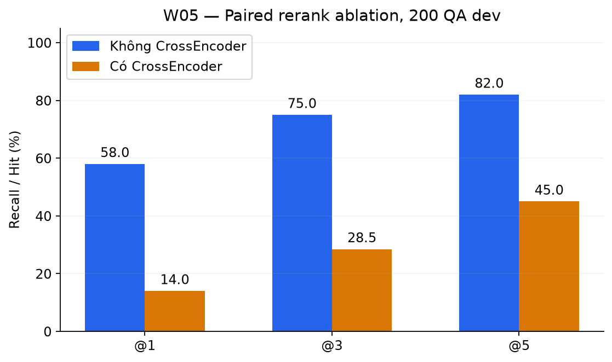
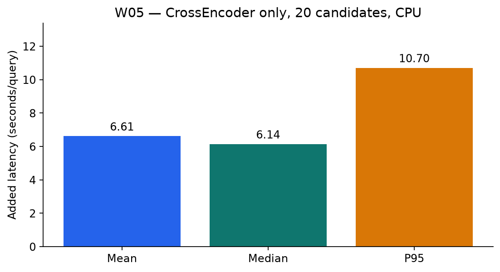

# W05 — CrossEncoder reranking: paired ablation

Thời gian kế hoạch: **25/10–31/10/2026**. Thực nghiệm chung: **31/10/2026**. Đóng gói GitHub và kiểm tra lại: **01/11/2026**; không backdate lịch sử Git.

## Thiết kế thực nghiệm

200 QA dev = 46 giao thông + 154 lao động, chứa 150 dev W4 và pilot. Dense top-25 + BM25 top-25 → RRF k=60 → **cùng 20 ứng viên** cho hai nhánh. Không CE: top-5 RRF; có CE: chấm lại 20 ứng viên rồi lấy top-5. Checkpoint `bhuy71/rerank_model`, max 512 token/cặp, FP32, CPU, batch 4, PyTorch 8 thread. Giải gạch dưới/chuẩn hóa khoảng trắng theo utility, score không phải xác suất đúng pháp lý.

| Chỉ số | Không CrossEncoder | Có CrossEncoder |
|---|---:|---:|
| Recall@1 | 58,00% | 14,00% |
| Recall@3 | 75,00% | 28,50% |
| Recall@5 | 82,00% | 45,00% |
| MRR@5 | 0,6732 | 0,2359 |

Recall@5 giảm **37 điểm phần trăm** (164 → 90 câu). Tại top-5: cả hai tìm được 85; CE cải thiện 5; CE làm suy giảm 79; cả hai không tìm được 31. Theo domain: giao thông 89,13% → 54,35%; lao động 79,87% → 42,21%.

Điều nhãn có trong tập 20 ứng viên ở 175/200 câu (87,50%); CE không khôi phục được 25 câu thiếu nguồn ngay từ candidate pool. CE bổ sung trung bình **6,61 s/câu**, median 6,14 s, P95 10,70 s; không phải tổng latency chat.

Kết quả hiện tại không chứng minh lợi ích của checkpoint/config CE này trên nhãn đang dùng. Nguyên nhân chưa được xác định. Cần kiểm tra nhãn, input preprocessing, cách dùng checkpoint và truncation 512 token; đây là hướng điều tra, không phải lỗi đã được chứng minh hoặc đã sửa. Không đổi nhãn/config để làm đẹp điểm và không suy rộng rằng mọi CrossEncoder đều không phù hợp.

W4 dùng 150 câu/top-50 nhánh, W5 dùng 200 câu/top-25 nhánh; chỉ so tác động CE bằng hai arm ghép cặp trong W5. [200 QA](../_shared/data/qa_w5_200.jsonl), [predictions](predictions.jsonl), [rerank code](../_shared/source_snapshot/source/rerank/utils_rerank.py).

## Theo dõi trên GitHub

- [Milestone Tuan5](https://github.com/whyalwaysme2x4/VietnameseLegal-QuestionAnsweringSystem/milestone/2).
- [Issue thực hiện của Tăng Minh Quang](https://github.com/whyalwaysme2x4/VietnameseLegal-QuestionAnsweringSystem/issues/3).
- [Issue kiểm tra/review của Đỗ Văn Đức](https://github.com/whyalwaysme2x4/VietnameseLegal-QuestionAnsweringSystem/issues/4).
- Nhánh: `evidence/w05`. Snapshot tuần: `w05`.
- Đỗ Văn Đức (`@dovanduc2004`) phụ trách kiểm tra kết quả/review. Trạng thái truy cập: `collaborator_confirmed`. Review thực tế vẫn chưa hoàn tất.
- Trạng thái: **chờ review thực tế**, chưa nghiệm thu hoặc merge thay reviewer.
- PR: https://github.com/whyalwaysme2x4/VietnameseLegal-QuestionAnsweringSystem/pull/6.
- Snapshot tag ban đầu được giữ nguyên; cập nhật reviewer nằm trong HEAD của PR, không di chuyển tag đã push.

## Đọc và kiểm tra evidence

`metrics.csv` lưu số thực 0–1 cho recall/MRR, không phải phần trăm; cột `unit`, `n`, `k`, `domain` xác định phép đo. `test-results.json` là kiểm tra offline dữ liệu/evidence ngày 01/11/2026, **không phải model inference mới hoặc chấm đúng pháp luật**. `manifest.json` khóa hash artifact và nối tới snapshot chung.

Từ gốc repo: `python Evidence/tools/validate_evidence.py`. Không cần model, GPU hoặc AWS. Dữ liệu quan sát chung được lưu nguyên bytes tại `../_shared/measurement_20261031/`. Xem [hướng dẫn snapshot và tái lập](../_shared/README.md).

## Giới hạn

Phạm vi 53 văn bản, hai domain; mốc tham chiếu 01/07/2026 chưa được kiểm chứng hiệu lực đầy đủ. Một Điều nhãn/câu nên Recall@k = Hit@k trên nhãn đó; k là chunk, không phải Điều duy nhất. Nhãn/relevant set chưa được rà đầy đủ, dev chứa pilot và không phải independent test. Domain lấy sẵn từ QA, chưa đo routing. Chưa xác định overlap với train. Điểm retrieval không chứng minh đáp án hoặc Khoản/Điểm đúng pháp lý; không có lời gọi Nova/web trong benchmark.
